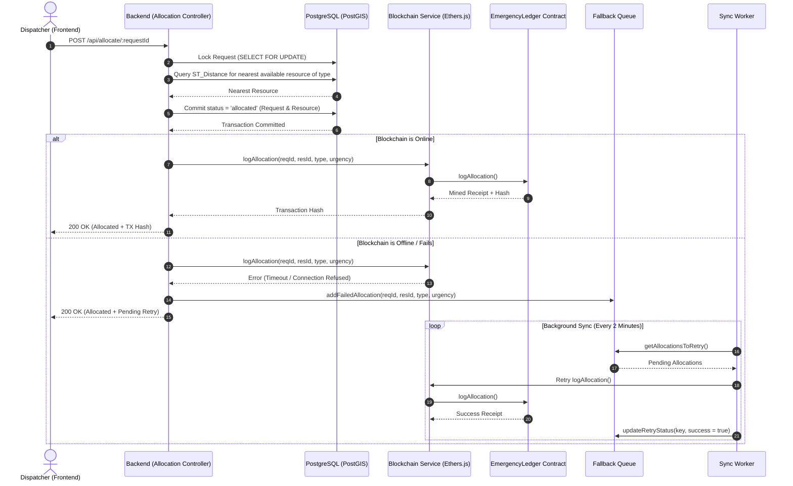

# Resilient Emergency Resource Allocation System

A fault-tolerant, decentralized emergency dispatch platform that pairs real-time geospatial resource matching with immutable blockchain auditing and an asynchronous fallback synchronization engine.

---

## Table of Contents

- [Overview](#overview)
- [System Architecture](#system-architecture)
- [Key Features](#key-features)
- [Repository Structure](#repository-structure)
- [Prerequisites](#prerequisites)
- [Configuration & Environment Variables](#configuration--environment-variables)
- [Step-by-Step Setup Guide](#step-by-step-setup-guide)
  - [1. Database Setup (PostgreSQL + PostGIS)](#1-database-setup-postgresql--postgis)
  - [2. Blockchain Setup (Hardhat Local Node & Smart Contract)](#2-blockchain-setup-hardhat-local-node--smart-contract)
  - [3. Backend Setup (Express API & Sync Engine)](#3-backend-setup-express-api--sync-engine)
  - [4. Frontend Setup (React Dashboard)](#4-frontend-setup-react-dashboard)
- [API Reference](#api-reference)
  - [Emergency Requests](#emergency-requests)
  - [Resources](#resources)
  - [Allocation & Dispatch](#allocation--dispatch)
  - [Health Check](#health-check)
- [Smart Contract Specification](#smart-contract-specification)
- [Resilience & Fallback Mechanism](#resilience--fallback-mechanism)
- [Testing & Verification Flow](#testing--verification-flow)
- [License](#license)

---

## Overview

In critical emergency response scenarios, dispatch operations must meet three strict demands:
1. **Immediate Execution**: Emergency units (ambulances, fire engines, police units) must be dispatched without blocking on external network latency or ledger confirmation delays.
2. **Geospatial Precision**: The nearest qualified, available resource must be identified using true surface distance metrics.
3. **Immutable Accountability**: Every dispatch action must be permanently logged for post-incident audits and cross-agency verification.

This system solves these challenges by combining **PostgreSQL + PostGIS** for sub-millisecond geospatial nearest-neighbor queries with **Ethereum smart contracts** for tamper-proof logging. If blockchain nodes become unreachable or face network congestion, a built-in **in-memory Fallback Queue and Background Sync Worker** guarantees eventual consistency without disrupting live dispatch operations.

---

## System Architecture

```mermaid
flowchart TD
    subgraph Client ["Client Layer"]
        UI["React 19 Dashboard (Vite)"]
    end

    subgraph Backend ["Backend API & Services (Express / Node.js)"]
        API["REST Controllers"]
        AllocService["Allocation Service"]
        DBTx["Sequelize Transaction (Row Locks)"]
        BCService["Blockchain Service (ethers.js)"]
        Fallback["Fallback Queue (In-Memory)"]
        Sync["Background Sync Worker (2-min interval)"]
    end

    subgraph Data ["Data & Storage Layer"]
        PG[("PostgreSQL + PostGIS\n(ST_Distance Geography)")]
    end

    subgraph DistributedLedger ["Decentralized Audit Layer"]
        Node["Ethereum / Hardhat EVM Node"]
        Contract["EmergencyLedger.sol\n(AllocationLogged Event)"]
    end

    %% Client Interactions
    UI -->|1. Submit Request / Resource| API
    UI -->|2. Trigger Dispatch| API
    UI -->|Polling Refresh (5s)| API

    %% Allocation Workflow
    API --> AllocService
    AllocService -->|Geospatial Query| PG
    API --> DBTx
    DBTx -->|Commit State: 'allocated'| PG

    %% Blockchain Integration
    API -->|Async Log Attempt| BCService
    BCService -->|Emit Event| Contract
    Contract -.->|Mined On| Node

    %% Fallback Loop
    BCService -- Network Failure / Error --> Fallback
    Sync -->|Check Every 2 Min| Fallback
    Sync -->|Retry Unsynced Allocations| BCService
```

### Allocation & Fallback Sequence Flow



---

## Key Features

- **PostGIS Geospatial Distance Matching**: Computes accurate ellipsoidal geodesic distance using `ST_Distance(..., geography)` to pair emergencies with the closest suitable unit.
- **Race-Condition-Safe Concurrency**: Employs Sequelize row-level update locks (`LOCK.UPDATE`) in atomic database transactions to eliminate double-allocation race conditions.
- **Immutable Smart Contract Logging**: Emits an indexed `AllocationLogged` Solidity event containing the request ID, resource ID, emergency category, urgency, caller address, and block timestamp.
- **Resilient Fallback & Eventual Consistency**: Uncouples emergency dispatch from blockchain connectivity. Failures are captured in a retry queue and automatically reconciled by a background worker when connectivity is restored.
- **Real-Time Live Dashboard**: A modern React 19 interface with live 5-second polling, status badge styling, request submission, resource provisioning, and single-click dispatch triggers.

---

## Repository Structure

```
resilient-emergency-allocation/
├── README.md                           # Master system documentation
├── backend/                            # Node.js Express REST API & Services
│   ├── app.js                          # Express entry point & server bootstrapper
│   ├── package.json                    # Backend dependencies & run scripts
│   ├── config/
│   │   └── database.js                 # Sequelize database connection setup
│   ├── controllers/
│   │   ├── allocationController.js     # Dispatch handler with DB tx & fallback
│   │   ├── emergencyRequestController.js # Emergency request CRUD operations
│   │   └── resourceController.js       # Resource registration & listing
│   ├── models/
│   │   ├── EmergencyRequest.js         # Emergency request PostGIS model
│   │   ├── Resource.js                 # Emergency resource PostGIS model
│   │   └── index.js                    # Model associations & database synchronization
│   ├── routes/
│   │   ├── allocationRoutes.js         # /api/allocate endpoints
│   │   ├── emergencyRequestRoutes.js   # /api/requests endpoints
│   │   └── resourceRoutes.js           # /api/resources endpoints
│   └── services/
│       ├── allocationService.js        # PostGIS raw SQL nearest-neighbor query
│       ├── blockchainService.js        # Ethers.js integration with smart contract
│       ├── fallbackService.js          # In-memory retry queue & scheduling state
│       └── syncService.js              # Background retry worker
├── blockchain/                         # Ethereum Smart Contracts & Hardhat tooling
│   ├── hardhat.config.js               # Hardhat EVM compiler & network configuration
│   ├── package.json                    # Smart contract toolchain dependencies
│   ├── contracts/
│   │   ├── EmergencyLedger.sol         # Main audit ledger contract with access control
│   │   └── Lock.sol                    # Reference template contract
│   ├── scripts/
│   │   └── deploy.js                   # Deployment script for EmergencyLedger
│   └── test/
│       └── Lock.js                     # Smart contract tests
└── frontend/                           # React 19 Dashboard (Vite)
    ├── index.html                      # Single page HTML entry
    ├── vite.config.js                  # Vite bundler configuration
    ├── package.json                    # Frontend dependencies & run scripts
    └── src/
        ├── App.jsx                     # Core dashboard view & data polling
        ├── App.css                     # Main layout & grid styles
        ├── index.css                   # Global CSS resets
        ├── main.jsx                    # React DOM bootstrapper
        └── components/
            ├── AddResourceForm.jsx     # Form to register new dispatch units
            ├── CreateRequestForm.jsx   # Form to submit emergency distress calls
            ├── Header.jsx              # Navigation and status header
            ├── RequestList.jsx         # Card list of requests with allocate button
            └── ResourceList.jsx        # Live inventory of vehicles and responders
```

---

## Prerequisites

Before starting, ensure the following software is installed on your system:

| Dependency | Minimum Version | Notes |
| :--- | :--- | :--- |
| **Node.js** | `>= 18.0.0` | Node.js runtime (LTS recommended) |
| **npm** or **yarn** | `>= 9.0.0` | Package manager |
| **PostgreSQL** | `>= 14.0` | Relational database server |
| **PostGIS** | `>= 3.0` | Geospatial extension for PostgreSQL |

---

## Configuration & Environment Variables

Create a `.env` file in the `backend/` directory:

```bash
# Path: backend/.env

# Server Configuration
SERVER_PORT=5050

# PostgreSQL Database Configuration
DB_NAME=emergency_db
DB_USER=postgres
DB_PASSWORD=your_postgres_password
DB_HOST=127.0.0.1
DB_PORT=5432

# Blockchain & EVM Configuration
# Hardhat local node default RPC URL
BLOCKCHAIN_RPC_URL=http://127.0.0.1:8545

# Deployer / Logger private key (Account #0 provided by `npx hardhat node`)
DEPLOYER_PRIVATE_KEY=0xac0974bec39a17e36ba4a6b4d238ff944bacb478cbed5efcae784d7bf4f2ff80

# Address output from running `npx hardhat run scripts/deploy.js --network localhost`
EMERGENCY_LEDGER_CONTRACT_ADDRESS=0x5FbDB2315678afecb367f032d93F642f64180aa3
```

> [!NOTE]
> The private key above is Hardhat's default Account #0 public test private key. **Never** use real private keys or funds on test configurations.

---

## Step-by-Step Setup Guide

Follow these steps in separate terminal tabs to run the complete ecosystem locally.

### 1. Database Setup (PostgreSQL + PostGIS)

1. Make sure your PostgreSQL server is active:
   ```bash
   # macOS (Homebrew)
   brew services start postgresql@14

   # Ubuntu / Debian Linux
   sudo systemctl start postgresql
   ```

2. Create the `emergency_db` database:
   ```bash
   createdb emergency_db
   ```
   *(Or inside `psql`: `CREATE DATABASE emergency_db;`)*

3. Enable the PostGIS spatial extension on the database:
   ```bash
   psql -d emergency_db -c "CREATE EXTENSION postgis;"
   ```

4. Verify PostGIS is activated:
   ```bash
   psql -d emergency_db -c "SELECT PostGIS_Version();"
   ```

---

### 2. Blockchain Setup (Hardhat Local Node & Smart Contract)

1. Open a new terminal tab and navigate into the `blockchain/` folder:
   ```bash
   cd blockchain
   npm install
   ```

2. Start a local Ethereum test node:
   ```bash
   npx hardhat node
   ```
   *Keep this process running. It will expose a JSON-RPC endpoint at `http://127.0.0.1:8545` and generate 20 pre-funded test accounts.*

3. Open another terminal tab and deploy `EmergencyLedger.sol` to your local node:
   ```bash
   cd blockchain
   npx hardhat run scripts/deploy.js --network localhost
   ```

4. Note the deployed contract address from the output:
   ```text
   Deploying EmergencyLedger contract...
   Deploying contracts with the account: 0xf39Fd6e51aad88F6F4ce6aB8827279cffFb92266
   EmergencyLedger deployed to: 0x5FbDB2315678afecb367f032d93F642f64180aa3
   ```
   *Copy this address and set `EMERGENCY_LEDGER_CONTRACT_ADDRESS` in `backend/.env`.*

---

### 3. Backend Setup (Express API & Sync Engine)

1. Open a new terminal tab and navigate into the `backend/` folder:
   ```bash
   cd backend
   npm install
   ```

2. Verify that `backend/artifacts` has the compiled smart contract ABI. If `blockchain/artifacts` was generated during compilation, the backend links directly to:
   `../blockchain/artifacts/contracts/EmergencyLedger.sol/EmergencyLedger.json`

3. Create or verify your `backend/.env` file with matching database credentials and the deployed contract address.

4. Start the backend server:
   ```bash
   # Development mode with hot-reload
   npm run dev

   # Or standard production mode
   npm start
   ```

   Expected output:
   ```text
   Database connection established successfully.
   All models were synchronized successfully.
   BlockchainService initialized. Connected to contract at: 0x5FbDB2315678afecb367f032d93F642f64180aa3
   Starting background sync service...
   Backend server is running on port 5050
   ```

---

### 4. Frontend Setup (React Dashboard)

1. Open a new terminal tab and navigate into `frontend/`:
   ```bash
   cd frontend
   npm install
   ```

2. Start the Vite development server:
   ```bash
   npm run dev
   ```

3. Open your browser and navigate to:
   ```
   http://localhost:5173
   ```

---

## API Reference

The backend exposes RESTful endpoints under `/api`.

### Health Check

#### `GET /api/health`
Verifies server liveness.

- **Response `200 OK`**:
  ```json
  {
    "message": "Server is running!"
  }
  ```

---

### Emergency Requests

#### `POST /api/requests`
Creates a new emergency incident request.

- **Request Body**:
  ```json
  {
    "type": "medical",
    "urgency": "critical",
    "location": {
      "type": "Point",
      "coordinates": [-122.4194, 37.7749]
    }
  }
  ```
  *(Note: GeoJSON coordinates order is `[longitude, latitude]`)*

- **Fields**:
  - `type` (`string`): e.g., `"medical"`, `"fire"`, `"police"`, `"natural disaster"`
  - `urgency` (`string`): `"low"` | `"medium"` | `"high"` | `"critical"`
  - `location` (`object`): GeoJSON Point geometry

- **Response `201 Created`**:
  ```json
  {
    "message": "Emergency request created successfully.",
    "request": {
      "id": 1,
      "type": "medical",
      "urgency": "critical",
      "status": "pending",
      "location": {
        "type": "Point",
        "coordinates": [-122.4194, 37.7749]
      },
      "createdAt": "2026-10-26T12:00:00.000Z",
      "updatedAt": "2026-10-26T12:00:00.000Z"
    }
  }
  ```

#### `GET /api/requests`
Returns all emergency requests ordered chronologically by newest first.

- **Response `200 OK`**:
  ```json
  [
    {
      "id": 1,
      "type": "medical",
      "urgency": "critical",
      "status": "pending",
      "location": {
        "type": "Point",
        "coordinates": [-122.4194, 37.7749]
      },
      "createdAt": "2026-10-26T12:00:00.000Z"
    }
  ]
  ```

#### `GET /api/requests/:id`
Retrieves a specific emergency request by ID.

---

### Resources

#### `POST /api/resources`
Registers a new emergency response unit.

- **Request Body**:
  ```json
  {
    "name": "Ambulance Unit 10",
    "type": "medical",
    "status": "available",
    "driverId": "driver-042",
    "location": {
      "type": "Point",
      "coordinates": [-122.4180, 37.7755]
    }
  }
  ```

- **Fields**:
  - `name` (`string`): Identifying name of the vehicle or unit
  - `type` (`string`): Matching request types (`"medical"`, `"fire"`, `"police"`, etc.)
  - `status` (`string`): `"available"` | `"allocated"` | `"busy"` | `"offline"`
  - `driverId` (`string`, optional): Assigned responder identifier
  - `location` (`object`): GeoJSON Point geometry

- **Response `201 Created`**:
  ```json
  {
    "message": "Resource created successfully.",
    "resource": {
      "id": 1,
      "name": "Ambulance Unit 10",
      "type": "medical",
      "status": "available",
      "driverId": "driver-042",
      "location": {
        "type": "Point",
        "coordinates": [-122.4180, 37.7755]
      }
    }
  }
  ```

#### `GET /api/resources`
Returns all registered resources in the system.

#### `GET /api/resources/:id`
Retrieves a single resource by ID.

---

### Allocation & Dispatch

#### `POST /api/allocate/:requestId`
Executes intelligent geospatial allocation for the target pending request.

1. Acquires database update locks (`LOCK.UPDATE`) on the request.
2. Runs PostGIS `ST_Distance` on geography to find the nearest resource where `type = request.type` and `status = 'available'`.
3. Sets both request and resource statuses to `'allocated'` and commits the database transaction.
4. Posts the transaction to `EmergencyLedger.sol` via `BlockchainService`.
5. If the smart contract call succeeds, returns the mined Ethereum transaction hash.
6. If the smart contract call fails, stores the item in `FallbackService` for background reconciliation and responds with `200 OK`.

- **Success Response (Blockchain OK) `200 OK`**:
  ```json
  {
    "message": "Resource allocated and transaction logged on blockchain successfully.",
    "request": {
      "id": 1,
      "status": "allocated"
    },
    "allocatedResource": {
      "id": 1,
      "name": "Ambulance Unit 10",
      "status": "allocated"
    },
    "blockchainTransactionHash": "0x4b7f...c3a9"
  }
  ```

- **Fallback Response (Blockchain Down) `200 OK`**:
  ```json
  {
    "message": "Resource allocated successfully, but could not log to blockchain. Will retry later.",
    "request": {
      "id": 1,
      "status": "allocated"
    },
    "allocatedResource": {
      "id": 1,
      "name": "Ambulance Unit 10",
      "status": "allocated"
    },
    "blockchainError": "could not detect network"
  }
  ```

- **Error Responses**:
  - `400 Bad Request`: Request is already allocated, en route, or resolved.
  - `404 Not Found`: Emergency request not found or no matching available resource within reach.
  - `409 Conflict`: Resource was claimed concurrently by another worker.

---

## Smart Contract Specification

The smart contract [`EmergencyLedger.sol`](file:///Users/aadi/Documents/git-repos-stash/resilient-emergency-allocation/blockchain/contracts/EmergencyLedger.sol) is compiled with Solidity `^0.8.19` (compatible with `0.8.28`).

### State Variables
- `address public allowedLogger`: Authorized wallet permitted to log transactions (the backend deployer wallet).

### Events
```solidity
event AllocationLogged(
    uint256 indexed requestId,
    uint256 indexed resourceId,
    string requestType,
    string urgency,
    address allocatedBy,
    uint256 timestamp
);
```

### Functions
- **`constructor(address _allowedLogger)`**: Sets the initial authorized backend address.
- **`logAllocation(uint256 _requestId, uint256 _resourceId, string calldata _requestType, string calldata _urgency) external`**:
  - Requires `msg.sender == allowedLogger`.
  - Emits `AllocationLogged` with the current `block.timestamp`.
- **`setAllowedLogger(address _newLogger) external`**:
  - Allows rotating the logging authority to a new backend wallet.

---

## Resilience & Fallback Mechanism

Emergency services cannot tolerate downtime. If an RPC node disconnects, a gas spike occurs, or the local blockchain halts, traditional systems fail the entire allocation request.

This system implements a decoupled fallback pattern:

1. **Immediate Local Persistence**: The database transaction commits first. Responders are dispatched immediately without delay.
2. **Graceful Degradation**: If `blockchainService.logAllocation()` fails or times out, the error is caught, logged as a warning, and sent to `FallbackService.addFailedAllocation()`.
3. **In-Memory Tracking**:
   - Unique key per allocation: `alloc_${requestId}_${resourceId}`
   - Tracks `retryCount` and `lastAttempt` timestamp
4. **Automated Background Sync**:
   - `SyncService` wakes up every 2 minutes (`2 * 60 * 1000` ms).
   - Iterates through pending items where `retryCount < 3` and elapsed time `> 5 minutes`.
   - Sends the transaction to `blockchainService.logAllocation()`.
   - On success: cleans up the entry from the queue.
   - On failure: increments `retryCount` and updates the timestamp for the next cycle.

---

## Testing & Verification Flow

### Happy Path (Full End-to-End Test)

1. Start all 3 components (Hardhat node, Backend, Frontend).
2. Open `http://localhost:5173`.
3. Add a resource:
   - Name: `Medic-1`
   - Type: `medical`
   - Status: `available`
   - Latitude: `37.7749`, Longitude: `-122.4194`
4. Add an emergency request:
   - Type: `medical`
   - Urgency: `critical`
   - Latitude: `37.7750`, Longitude: `-122.4190`
5. Click **Allocate Resource** on the request card.
6. Verify in the alert and browser console that a `blockchainTransactionHash` is returned.
7. Verify in the terminal running `npx hardhat node` that an `EmergencyLedger.logAllocation` transaction was mined.

### Fallback & Resilience Test

1. Stop the Hardhat node terminal (`Ctrl + C`).
2. Submit a new emergency request and resource.
3. Click **Allocate Resource**.
4. The UI displays success: `Resource allocated successfully, but could not log to blockchain. Will retry later.`
5. Notice that the resource and request statuses still correctly switch to **Allocated** in PostgreSQL.
6. Restart the Hardhat node (`npx hardhat node`).
7. Wait for the `SyncService` interval or trigger the sync; the worker detects the pending queue item, logs it to the restored blockchain, and outputs:
   ```text
   Retrying blockchain log for request 2...
   Allocation successfully logged on blockchain. Transaction Hash: 0x...
   ✅ Successfully synced allocation for request 2
   ```

---

## License

This project is licensed under the [ISC License](LICENSE).
